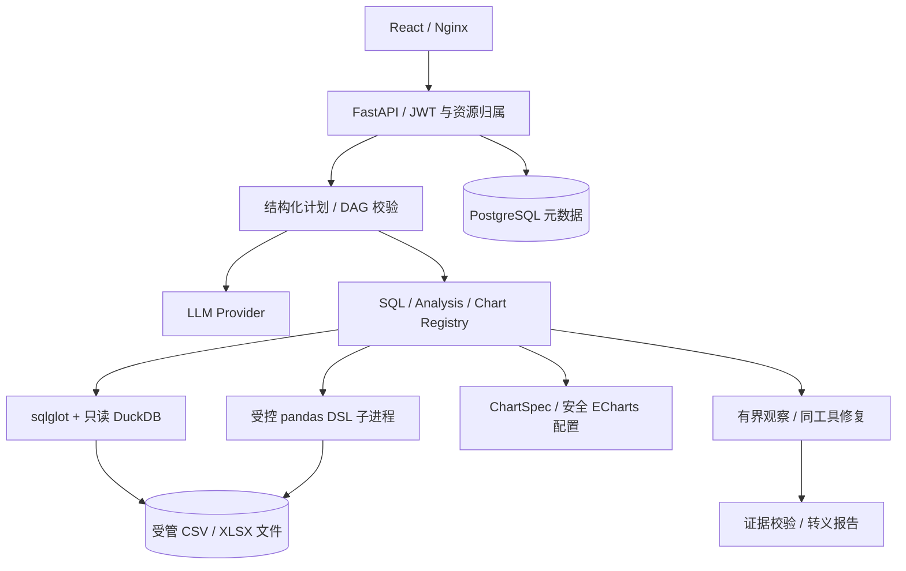
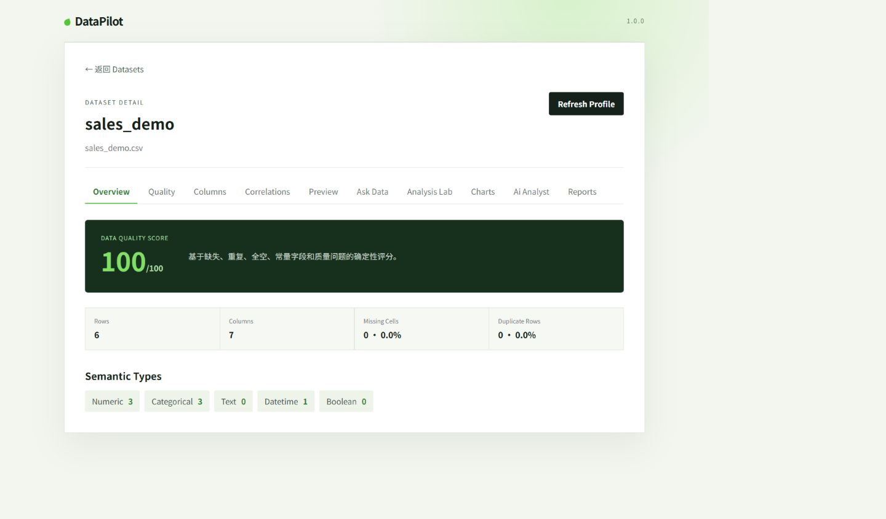
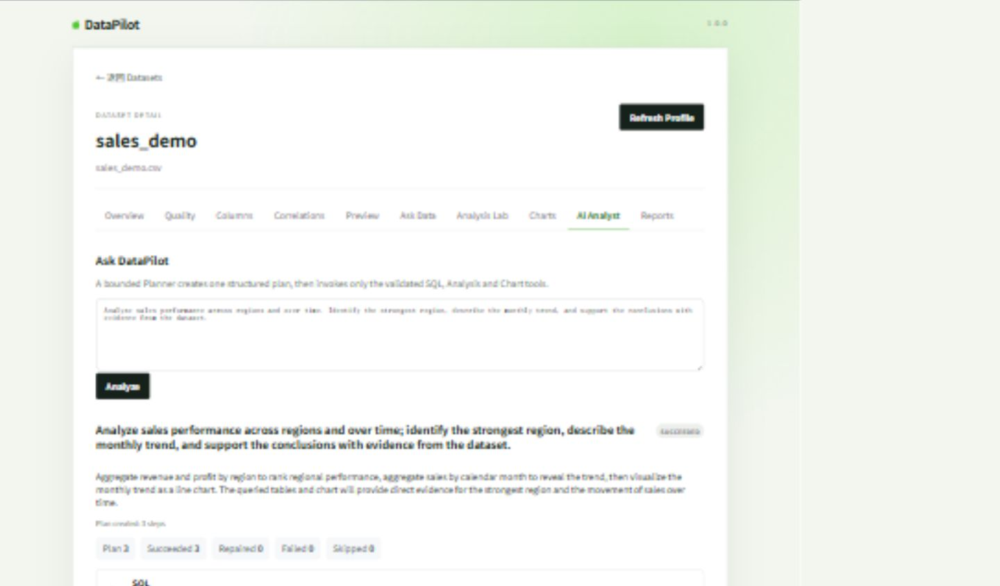

# DataPilot

面向 CSV/XLSX 数据探索的 AI Agent 分析平台。用户上传数据后，可查看质量画像、执行受控查询与分析、生成图表，并将有界 Agent 的执行结果整理为带证据引用的报告。

**工程定位：可追溯的单 Agent 工作流。** 模型提出结构化计划，应用负责授权、校验、执行与证据约束；没有已实施的 Multi-Agent、RAG 或分布式任务队列。

## 1. 项目简介

项目将“自然语言问题 → 结构化计划 → SQL/Analysis/Chart 工具 → 观察与受限修复 → 报告”串联起来，避免直接执行模型生成的 Python 或前端 JavaScript。

本地候选版本保留报告归属修复：读取、两种导出和删除均先验证当前用户拥有父数据集，再查询报告。2026-10-18 本地验收：306 项后端测试通过；远程旧版本尚未包含这两行修复，发布之前不应将其作为安全部署版本。

## 2. 技术栈

| 层 | 已使用技术 |
| --- | --- |
| 后端 | Python、FastAPI、Pydantic、SQLAlchemy、Alembic |
| 分析与 AI | DuckDB、pandas、NumPy、sqlglot、OpenAI-compatible Provider、自建有界 Agent |
| 存储 | PostgreSQL 元数据、本地受管上传目录 |
| 前端 | React、TypeScript、Vite、ECharts、Nginx |
| 工程 | Docker Compose、GitHub Actions、pytest、Vitest、Ruff、ESLint |

## 3. 系统架构



DuckDB 查询上传数据，PostgreSQL 保存元数据和执行记录。分析 Worker 是子进程，不是 OS 或 Docker 安全沙箱。

## 4. 核心功能

| 能力 | 源码入口 |
| --- | --- |
| 上传、预览、数据归属、配额和质量画像 | [services.py](backend/app/services.py)、[profiling](backend/app/profiling/) |
| 只读 SQL 与受控分析 | [query](backend/app/query/)、[analysis](backend/app/analysis/) |
| 图表规格校验与 ECharts 配置构造 | [charts](backend/app/charts/) |
| 有界计划、观察、修复与执行轨迹 | [agents](backend/app/agents/) |
| 证据引用报告与 Markdown/HTML 导出 | [reports](backend/app/reports/) |

## 5. 关键工程实现与源码位置

- **已知资源 ID 也不能绕过归属。** [ReportService.get](backend/app/reports/service.py) 先通过 owner-scoped DatasetRepository 验证父资源；读取、导出和删除复用同一检查。[权限回归](backend/tests/test_resource_authorization.py) 覆盖用户 A/B、已知 ID、父数据集替换、未登录和正常流程。隔离副本撤去两行修复后，四个攻击用例全部失败；恢复后完整测试通过。
- **LLM 输出不是执行权限。** [SQLValidator](backend/app/query/validator.py) 限制单条只读查询与逻辑 dataset 表；分析使用 Pydantic DSL 和有界子进程，图表由服务端生成配置。SQL AST 校验没有字段级授权 Schema，列存在性仍由执行层检查。
- **计划错误需要有界恢复。** [AgentRuntime](backend/app/agents/runtime.py) 使用工具 allowlist、依赖 DAG、步数、时间和修复预算；修复不能改变工具或拓扑。最终报告只接受已知证据 ID，并对输出转义。

## 6. 本地部署教程

需要 Docker Engine/Desktop 与 Compose v2，首次构建需要下载依赖。开发与测试应使用独立数据卷，不复用生产数据。

```powershell
git clone https://github.com/tangwencan666/DataPilot.git
cd DataPilot
Copy-Item .env.example .env
# 在本机私有 .env 中设置独立随机 SECRET_KEY、POSTGRES_PASSWORD；保持 AUTH_REQUIRED=true
docker compose config --quiet
docker compose up --build
```

打开 `http://localhost` 注册账号，上传 [演示数据](demo/sales_demo.csv)。OpenAPI 为 `http://localhost:8000/docs`，就绪接口 `/ready`，指标 `/metrics`。端口冲突时配置 `POSTGRES_PORT`、`BACKEND_PORT`、`FRONTEND_PORT`，不要停止未知服务。

没有 LLM Key 时，上传、画像、受控分析和图表仍可使用；自然语言 SQL、规划和报告生成会明确报未配置。真实模型需服务端设置 `LLM_API_KEY`、`LLM_BASE_URL`、`LLM_MODEL`，Key 不进入前端。停止可用 `docker compose down`，不添加删除卷参数。

本地候选补丁尚未提交，远程旧版本不含报告权限修复。部署修复前应先应用候选补丁并完成自己环境的验证。

## 7. 真实运行截图

以下复用仓库已有运行截图，本轮没有重新运行真实模型或生成界面。





[完整截图与来源](docs/screenshots/README.md) · [演示步骤](docs/demo-guide.md)。截图文档记录后续真实 DeepSeek 演示；1.0.0 发布时未做真实模型 smoke，两者属于不同时间点。

## 8. 测试结果与已知限制

```powershell
cd backend
python -m pytest -q
# 专项：python -m pytest tests/test_resource_authorization.py tests/test_report_api.py -q
cd ../frontend
npm test
npm run build
```

| 验证 | 结果与范围 |
| --- | --- |
| 2026-10-18 独立副本本地验收 | 306 passed；内存 SQLite、测试 Provider、独立上传目录，外部连接受限 |
| 权限失败对照 | 仅撤去隔离副本两行修复，四个跨用户读取/导出/删除用例失败；测试断言未改 |
| 历史公开 CI，Commit 18bd1d7 | 后端 254、前端 7 通过；不能替代本地新补丁的远程 CI |
| PostgreSQL Compose / 真实模型 | 历史记录保留；本轮未重跑 |

限流仍是进程内状态；没有分布式队列和 OS 级内存沙箱；上传文件未做恶意软件扫描。浏览器 JWT 使用 localStorage，现有权限控制不等于企业级租户隔离。依赖锁定不代表完成全部漏洞与供应链审计。

[阶段 B 历史记录](docs/PORTFOLIO_VERIFICATION.md) · [安全边界](docs/security.md) · [Threat Model](docs/threat-model.md) · [历史 README](docs/history/README.before-portfolio-20261018.md)

项目源码采用 [MIT License](LICENSE)，第三方依赖保留各自许可证。

[本地验收记录](docs/LOCAL_ACCEPTANCE.md) · [测试证据及版本索引](docs/TEST_EVIDENCE.md)
