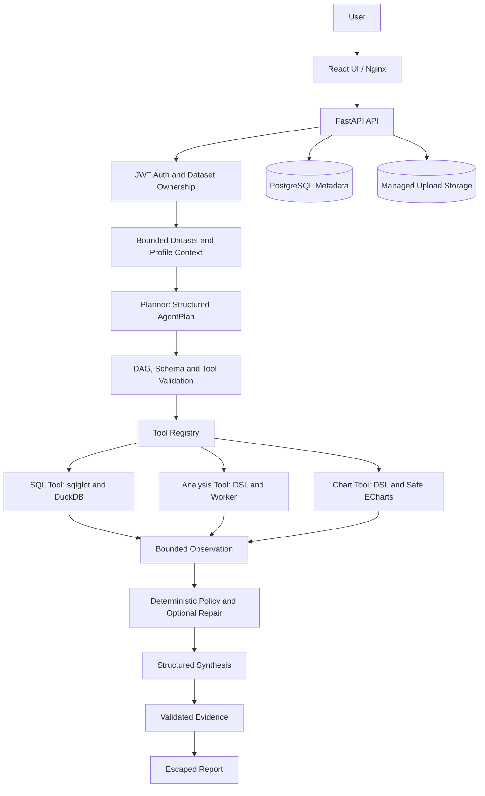

# DataPilot

[](https://github.com/tangwencan666/DataPilot/actions/workflows/ci.yml)

AI-powered data analysis agent platform with safe SQL, structured analysis, visualization, and evidence-backed reporting.

DataPilot turns uploaded CSV/XLSX datasets into inspectable analysis workflows. Users can profile data, run controlled analyses, build charts, or ask a higher-level question. The planner produces a bounded structured plan; the application validates and executes each step through an allowlisted tool, records observations and controlled repairs, then synthesizes a response and evidence-backed report.

> Version 1.0.0 · verified against PostgreSQL 16.15 and the real Docker Compose stack. LLM-backed flows require optional provider configuration.

## Key features

- Dataset upload, preview, ownership, quotas, and cleanup
- Deterministic profiling, semantic types, correlations, and data-quality findings
- Natural-language SQL with SQL transparency and query history
- `sqlglot` AST validation and bounded read-only DuckDB execution
- Controlled analysis DSL for aggregation, statistics, time series, and derived columns
- Structured visualization DSL and server-built safe ECharts options
- Bounded planner, validated dependency DAG, tool registry, and execution trace
- Structured observation, deterministic failure classification, and controlled repair
- Evidence-referenced insights and escaped Markdown/HTML reports
- JWT authentication, owner-scoped resources, rate limiting, request IDs, and metrics
- Docker Compose, Alembic migrations, CI, and automated tests

## Architecture



The LLM proposes structured data; it is not treated as a security boundary. The application owns validation, authorization, resource limits, execution, evidence checks, and rendering. See [Architecture](docs/architecture.md), [Security](docs/security.md), and [Threat Model](docs/threat-model.md).

## Safety architecture

| Boundary | Controls |
|---|---|
| SQL | `sqlglot` validates one read-only SELECT/CTE against the logical `dataset` table. External readers, destructive statements, extensions, and unsafe commands are rejected. DuckDB enforces row, cell, SQL-length, and timeout limits. |
| Analysis | A Pydantic operation DSL replaces source code. A spawned worker executes allowlisted pandas operations under row/result/operation/time limits. There is no `exec`, `eval`, arbitrary import, expression, or file-path input. |
| Charts | A strict `ChartSpec` controls aggregation and presentation. The server builds ECharts options; raw JavaScript, callbacks, formatter functions, custom renderers, and raw options are rejected. |
| Agent | Plans have a default eight-step maximum, tool allowlist, prior-step dependencies, and DAG/schema/column validation. Repair cannot change tool or topology; default budgets are one repair per step and three per run. There is no unlimited ReAct loop. |
| Reports | Only bounded snapshots become evidence. Findings reference known evidence IDs; fixed templates escape content and never accept model-generated HTML or JavaScript. |
| Platform | Argon2 password hashes, short-lived JWTs, owner-scoped dataset resources, quotas, process-local rate limits, request IDs, security headers, and sanitized errors. |

These controls reduce application-level risk; they are not an OS sandbox, malware scanner, or enterprise multi-tenant isolation boundary.

## Quick start

Prerequisite: Docker Desktop, or Docker Engine with Compose v2.

```powershell
git clone <your-repository-url>
Set-Location <repository-directory>
Copy-Item .env.example .env
```

Replace at least `SECRET_KEY` and `POSTGRES_PASSWORD` in `.env`, then run:

```powershell
docker compose up --build
```

Open `http://localhost`, register an account, and upload [demo/sales_demo.csv](demo/sales_demo.csv). OpenAPI is at `http://localhost:8000/docs`; readiness and metrics are `/ready` and `/metrics`.

If host port 5432 is occupied, set `POSTGRES_PORT=55432` (or another free port) in `.env`. The backend still connects inside Compose on port 5432. Stop without deleting persisted data with `docker compose down`.

## Optional LLM configuration

The application starts without an LLM key. Dataset upload, preview, profiling, data quality, structured analysis, and charts remain available. To enable natural-language SQL, planner/repair/synthesis, and report insight generation, set:

```dotenv
LLM_API_KEY=<your-provider-key>
LLM_BASE_URL=https://api.openai.com/v1
LLM_MODEL=<structured-output-capable-model>
```

Keys remain server-side. Missing configuration produces explicit API errors rather than mock results or paid calls.

## Demo

The synthetic, PII-free [sales dataset](demo/sales_demo.csv) contains `date`, `region`, `product`, `category`, `sales`, `quantity`, and `profit`.

- Follow the [5–8 minute demo guide](docs/demo-guide.md).
- Use the prepared [demo questions](demo/demo_questions.md).

## Screenshots

Screenshots will be added from the verified 1.0.0 UI. Until then, the [screenshot checklist](docs/screenshots/README.md) documents the real views to capture; no generated UI images or broken screenshot links are included.

## Technology stack

| Area | Technology |
|---|---|
| Frontend | React, TypeScript, Vite, ECharts, Nginx |
| Backend | FastAPI, Pydantic, SQLAlchemy, Alembic |
| Database | PostgreSQL 16 |
| Analytics | DuckDB, pandas, NumPy, `sqlglot` |
| Agent | Structured plans, tool registry, bounded observation and repair |
| Infrastructure | Docker Compose, managed upload volume, GitHub Actions |
| Testing | pytest, Vitest, Testing Library, Ruff, ESLint |

## Project structure

```text
backend/             FastAPI application, migrations, and tests
frontend/            React application and frontend tests
docs/                Architecture, security, demo, and portfolio material
demo/                Synthetic demo dataset and questions
scripts/             Demo and migration verification utilities
.github/workflows/   Continuous integration
docker-compose.yml   PostgreSQL, backend, and frontend stack
```

## API overview

The API is rooted at `/api/v1`. Auth endpoints register/login users; authenticated dataset endpoints provide preview/profile/query/analysis/chart/agent/report workflows. Ownership applies to all dataset child resources. See [API overview](docs/api-overview.md) or live OpenAPI at `/docs`.

## Engineering verification

| Check | Verified result |
|---|---|
| Release | 1.0.0 |
| Backend tests | 249 passed |
| Frontend tests | 6 passed |
| Alembic | 9 revisions; `0001 → 0009` and round-trip verified |
| PostgreSQL | 16.15 real-container migration and smoke verification |
| Docker | Backend/frontend builds and full Compose flow verified |
| Quality gates | Ruff, format check, ESLint, TypeScript, and Vite build passed |

These are engineering verification results, not production traffic or performance claims. Real LLM smoke testing was skipped because no provider credential was configured.

```powershell
Set-Location backend
.\.venv\Scripts\python.exe -m pytest
.\.venv\Scripts\python.exe -m ruff check .
.\.venv\Scripts\python.exe -m ruff format --check .

Set-Location ..\frontend
npm run lint
npm run test
npm run build
```

## Current limitations

- LLM-backed release smoke was not performed without external credentials.
- Rate limiting is in-memory and not shared across replicas.
- Uploads use a local managed volume; long-running work has no distributed queue.
- The analysis worker has process isolation and time limits, but no OS-level memory sandbox.
- Uploaded files are type/size/path checked but not malware-scanned.
- The ECharts bundle remains a large lazy-loaded frontend chunk.
- Browser JWT storage uses localStorage; internet-facing deployments should evaluate secure HttpOnly cookies.

## Roadmap

- Redis-backed rate limiting and an asynchronous job queue
- Object storage and lifecycle management
- Container or microVM execution isolation
- Distributed tracing and centralized telemetry
- Optional PDF report export

No delivery dates are implied. The implementation remains a bounded single-agent workflow, not a multi-agent system.

## Documentation

- [Architecture](docs/architecture.md) · [Agent runtime](docs/agent-runtime.md)
- [Security](docs/security.md) · [Threat model](docs/threat-model.md)
- [API overview](docs/api-overview.md) · [Demo guide](docs/demo-guide.md)
- [Graduation defense](docs/graduation-defense.md) · [Interview guide](docs/interview-guide.md)
- [Resume material](docs/resume-project.md) · [Project highlights](docs/project-highlights.md)
- [Graduation summary](docs/graduation-summary.md) · [Release notes](docs/release-notes-1.0.0.md)
- [Changelog](CHANGELOG.md)

## License

This project is licensed under the MIT License. See [LICENSE](LICENSE) for details.
