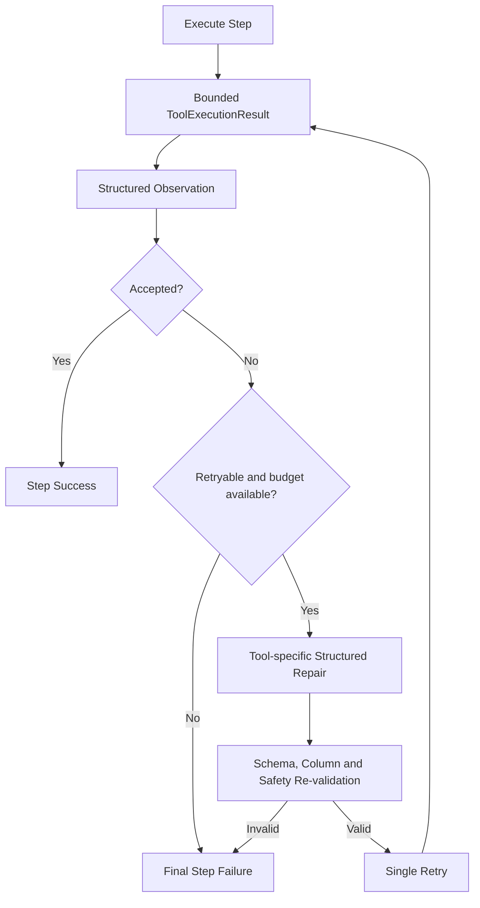

# Agent Runtime

Stage 7 是一次性的 `Plan → Validate → Execute → Synthesize`。Stage 8 在不改变计划结构和 Tool allowlist 的前提下增加受限观察与单步修复：`Execute → Observe → Classify → Repair → Re-validate → Retry once`。

## Bounds and policy

- Original plan remains a maximum-eight-step DAG; repair cannot add, delete, reorder or change a Tool.
- Per step repair budget is 1 and per Run budget is 3.
- Agent total deadline remains 60 seconds. Tool-specific timeouts still apply and timeout failures are not retried.
- Retryable categories are invalid column/type/aggregation, SQL syntax/validation, empty result and selected validation errors.
- Timeout, hard resource limit, LLM/auth/config, not-found, internal, unsupported and security failures are final.
- Dependent steps wait for the repaired step. They execute after successful repair and are skipped after final failure; independent steps continue.

## Tool-specific repair

SQL repair returns only a bounded natural-language sub-question and re-enters SQL generation, sqlglot AST validation and DuckDB execution. Analysis repair returns a Pydantic `AnalysisPlan` and re-enters the controlled executor. Chart repair returns a `ChartSpec` and re-enters column/type validation, data preparation and the Safe ECharts Builder. There is no raw SQL, Python, JavaScript, Shell, File, Browser, HTTP or generic repair Tool.

## Audit and privacy

`agent_step_attempts` records INITIAL/REPAIR, bounded input summary, structured observation, short repair summary, status, error and duration. It does not store prompts, hidden reasoning, traceback, full results, secrets, paths or Dataset content. Logs include run/dataset/step/tool/attempt/category/retry/duration fields only.
