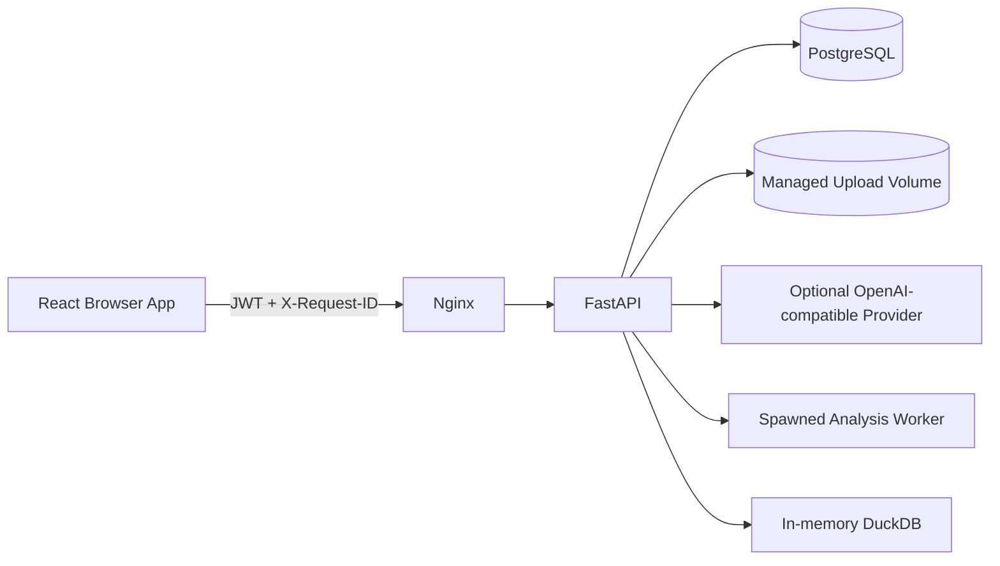
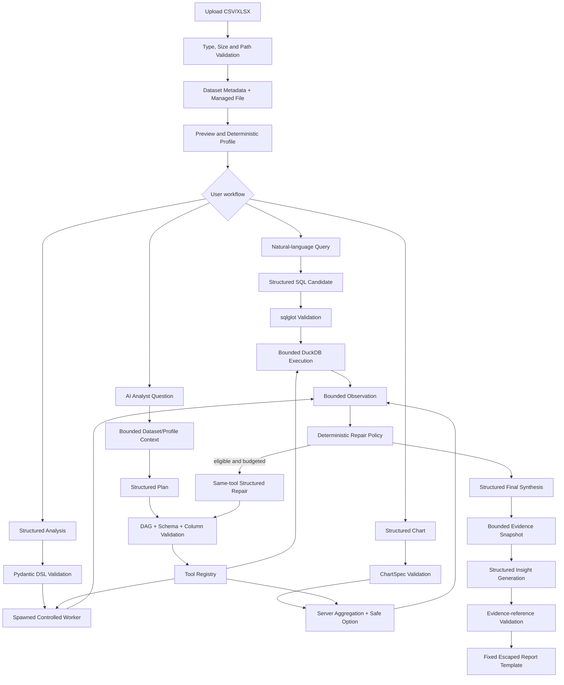

# DataPilot Architecture

This document explains the implemented data and control paths. It complements the product-oriented README.

## System boundaries

The Compose deployment contains PostgreSQL 16, a non-root FastAPI/Uvicorn backend, and an unprivileged Nginx frontend. PostgreSQL stores identities, dataset metadata, profiles, histories, agent traces, and reports. Uploaded CSV/XLSX files live in a managed volume; API callers never provide filesystem paths.

`/ready` checks database connectivity; LLM availability is intentionally not a readiness dependency. `/metrics` exposes Prometheus-compatible HTTP counters and latency histograms.

## End-to-end data flow

## Dataset lifecycle and ownership

Uploads are extension/MIME/size checked, assigned UUID filenames, resolved under the configured upload root, parsed, and recorded transactionally. Failures remove incomplete files. Deletion commits metadata removal and then removes the managed file; cleanup failures are logged for reconciliation.

All child services resolve their parent through an owner-scoped dataset repository. A foreign dataset ID therefore returns 404 consistently for Profile, Query, Analysis, Chart, Agent, and Report resources. Migration `20260830_0009` leaves legacy pre-auth rows nullable; authenticated uploads always receive an owner.

## Tool execution

SQL, Analysis, and Chart are adapters behind a small typed registry. The runtime cannot request Shell, File, Browser, HTTP, raw Python, raw SQL, or raw JavaScript tools. Each adapter re-enters the same validator used by its direct API; the agent has no bypass flag.

Intermediate results are kept only for one agent run and truncated by row/cell limits. Persistent step records contain bounded summaries, statuses, timing, errors, and artifact IDs—not entire datasets or hidden model reasoning.

## Observation and repair

After every tool attempt, the program converts the result into a bounded observation and classifies failures. Only selected validation, column/type/aggregation, SQL syntax/validation, and empty-result cases are repairable. Security, timeout, resource, LLM configuration, not-found, unsupported, and internal failures are final. A repair must keep the step ID and tool, pass the original validators, and stay within per-step and per-run budgets.

## Synthesis and reports

The final synthesizer receives the question, planner summary, and bounded step summaries. Reports are derived from a snapshot of succeeded/partial runs. Every generated insight references registered evidence; unknown references fail validation. Markdown and HTML are application templates with escaped content. The model does not generate report HTML.

## Deployment and persistence

Alembic is the schema authority; application startup upgrades to head rather than calling `create_all`. Compose persists PostgreSQL and uploads in separate named volumes. A complete backup needs both. The verified chain contains nine revisions through `20260830_0009`.

The current topology is intentionally simple: no Redis, Celery, Kubernetes, vector database, browser agent, or multi-agent service is present.
